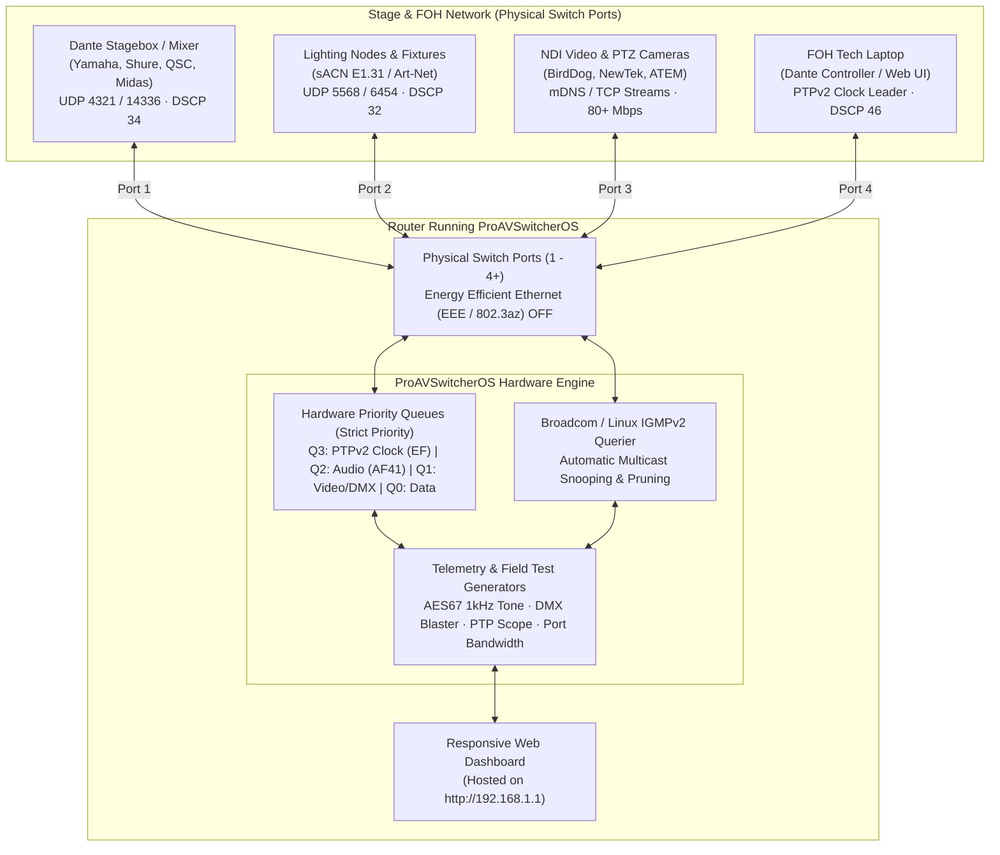
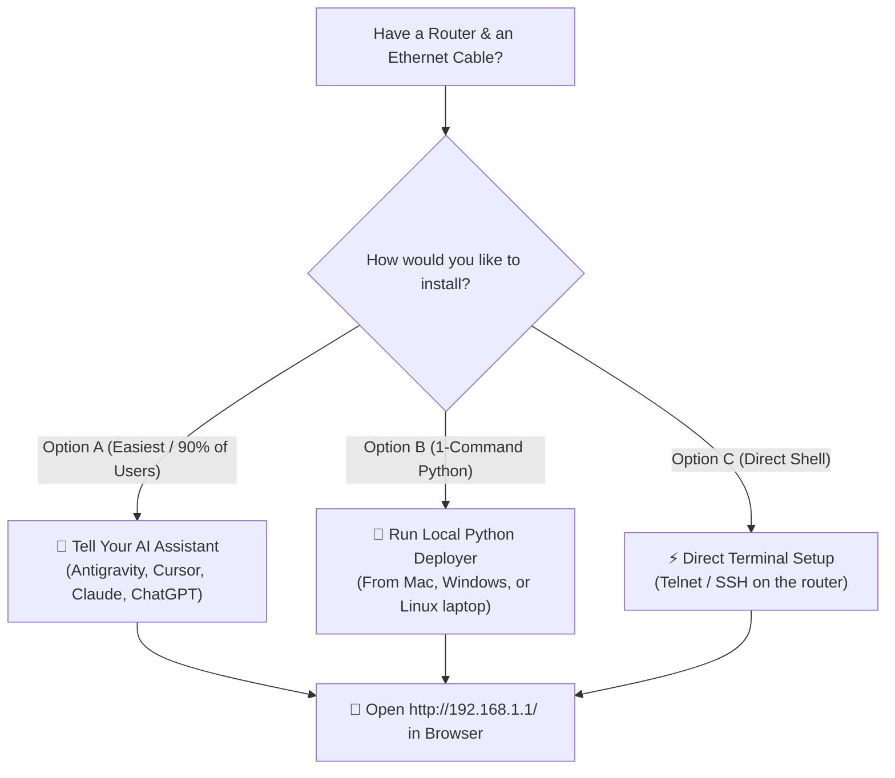
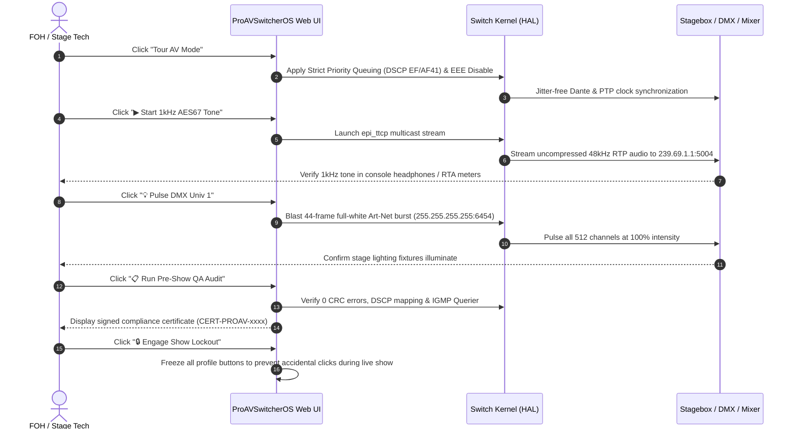
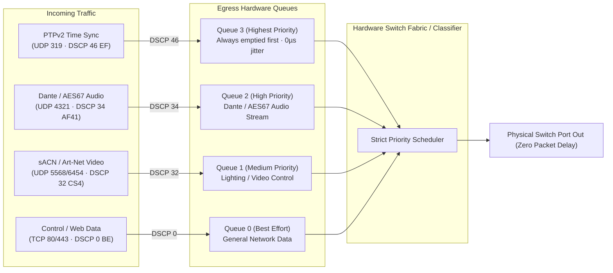

# ProAVSwitcherOS

[](LICENSE)
[]()
[]()
[](AGENTS.md)

**ProAVSwitcherOS** is a universal, open-source firmware overlay that transforms standard consumer, commercial, and ISP routers into dedicated, tour-grade Layer 2/3 Audio/Video network switchers.

Built for live sound engineers, lighting technicians, video directors, and flypack builders who need rock-solid Dante, AES67, NDI, sACN, and Art-Net performance without paying $1,500+ for enterprise managed switches.

---

## 📐 System Architecture & Signal Flow



---

## 🖥️ Live Web Dashboard Interface

When you open your router's IP in any browser, you get a zero-latency, high-contrast Dark/Tour UI designed for dark stage wings and bright outdoor sun:

```
┌─────────────────────────────────────────────────────────────────────────────────────────────────┐
│ ● PROAVSWITCHEROS · UNIVERSAL PRO-AV FLYPACK SWITCHER                [ TOUR AV MODE ] [ 100M ]  │
│   Hosted Natively on Switcher Hardware (http://192.168.1.1)          [ IGMP QUERIER ON ]        │
├─────────────────────────────────────────────────────────────────────────────────────────────────┤
│ NETWORK PROFILE SELECTOR:                                                                       │
│  [  ★ TOUR AV MODE (Dante/AES67/sACN EF Priority, EEE Off, IGMP Querier On)  ] <ACTIVE>        │
│  [    CORPORATE IT MODE (Standard Best-Effort, mDNS Filtered, Passive Snooping) ]               │
│  [    FLAT UNMANAGED MODE (Transparent L2 Bridge, QoS & Filtering Bypassed)    ]               │
├─────────────────────────────────────────────────────────────────────────────────────────────────┤
│ LIVE PROTOCOL & CLOCK TELEMETRY:                                                                │
│  PTPv2 CLOCK STATUS:        IGMP QUERIER STATUS:       ACTIVE MULTICAST GROUPS:  DSCP PRIORITY: │
│  LOCKED (±12µs Jitter)      ENABLED (V2 Querier)       14 Groups (mDNS Joined)   VERIFIED (EF)  │
│  Leader: 192.168.10.50      Emits Query Every 125s     Dante / AES67 Subscribed  Queue 3 (Strict│
├─────────────────────────────────────────────────────────────────────────────────────────────────┤
│ FIELD TEST BENCH & VIRTUAL GENERATORS:                                                          │
│  AES67 / RTP 1kHz TEST TONE:       sACN / ART-NET TACHOMETER:        DMX BLASTER OUTPUT STATUS: │
│  STREAMING (239.69.1.1:5004)       Univ 1: 44 fps (Art-Net)          Ready (Pulse Univ 1)       │
│                                                                                                 │
│  [ ▶ Start 1kHz Tone ]   [ 💡 Pulse DMX Univ 1 ]   [ 📋 Run QA Audit ]   [ 🕶 Stage Stealth ]   │
│  [ 🖨 Print Certificate ] [ 🔒 Lockout Show Mode ] [ ⬇ Download .PCAP ]   [ 📶 Toggle Wi-Fi ]   │
├─────────────────────────────────────────────────────────────────────────────────────────────────┤
│ PHYSICAL SWITCH PORTS (REAL-TIME THROUGHPUT & OS RECOGNITION):                                  │
│  PORT 1: MacBook Pro [macOS] · 192.168.10.50      │ RX: [████████░░░░] 38.4 Mbps │ TX:  4.2 Mbps│
│  PORT 2: Yamaha Commercial Audio (Rio Stagebox)   │ RX: [████░░░░░░░░] 12.1 Mbps │ TX: 12.1 Mbps│
│  PORT 3: BirdDog NDI Video Node                   │ RX: [████████████] 84.6 Mbps │ ⚠️ SATURATED  │
│  PORT 4: Unplugged (No Link)                      │ RX: 0.0 Mbps                 │ TX:  0.0 Mbps│
└─────────────────────────────────────────────────────────────────────────────────────────────────┘
```

---

## 🚀 How to Use It (Choose Your Path)

You can install and use ProAVSwitcherOS in **3 simple ways**:



---

### Option A: The AI-First Installation (Easiest)

> **No terminal experience required.** Hand the work to your AI assistant.

If you are using **Google Antigravity, Cursor, Claude Code, ChatGPT, Gemini, or GitHub Copilot**:

1. Connect your computer to the router via an Ethernet cable or Wi-Fi.
2. Clone this repository to your laptop:
   ```bash
   git clone https://github.com/nikhil-desai/ProAVSwitcherOS.git
   ```
3. Copy and paste the prompt from [**`AI_INSTALL_PROMPT.md`**](AI_INSTALL_PROMPT.md) directly into your AI chat window:

```markdown
"I have downloaded the ProAVSwitcherOS repository. Please read AGENTS.md
and install ProAVSwitcherOS on my router at 192.168.1.1 (username: admin, password: password)."
```

4. **What your AI does automatically:**
   - Probes the router's CPU architecture (MIPS, ARM, or x86).
   - Identifies writable flash storage (preventing RAM tmpfs overflow).
   - Stages the hardware abstraction layer and pro-AV scripts.
   - Binds the web dashboard to the router's native web server.
   - Activates **Tour AV Mode** (Dante DSCP QoS, EEE disabled, IGMP Querier active).
   - Gives you a clickable link to open your live dashboard!

---

### Option B: Automated 1-Click Python Deployer

If you have Python 3 installed on your Mac, Windows, or Linux laptop:

1. Connect to the router (via Ethernet cable or Wi-Fi).
2. Open your terminal in the cloned repository folder.
3. Run the universal deployer:

```bash
# For standard Telnet (port 23):
python3 installer/deploy.py --host 192.168.1.1 --proto telnet --user admin --password password

# Or for SSH (port 22):
python3 installer/deploy.py --host 192.168.1.1 --proto ssh --user root --password password
```

**Expected terminal output:**
```
[ProAVSwitcherOS] Starting deployment to 192.168.1.1:23 via TELNET...
[ProAVSwitcherOS] Serving installer payload from local machine at http://192.168.1.50:8080...
[ProAVSwitcherOS] Authenticating over Telnet...
[ProAVSwitcherOS] Probing target hardware and network stack...
[ProAVSwitcherOS] Hardware Detected: mips (big-endian), Family: broadcom-cpe
[ProAVSwitcherOS] Memory: 3240 KB free / 59004 KB total
[ProAVSwitcherOS] Staging core payload (Destination: /data)...
[ProAVSwitcherOS] Binding Web Dashboard to router web root (/webs)...
[ProAVSwitcherOS] Starting universal pro-AV telemetry & auditor daemon...
======================================================================
 [ProAVSwitcherOS] SUCCESS! Router converted to Professional AV Switcher.
 Dashboard URL:  http://192.168.1.1/
 Active Profile: Tour AV Mode (Dante EF/AF41 QoS, EEE Off, IGMP Querier On)
 Features:       PTPv2 Scope, DMX Blaster, AES67 Tone, Port Bandwidth Gauges
======================================================================
```

Open **`http://192.168.1.1/`** in your browser and you're ready for showtime.

---

### Option C: Direct On-Device Setup (For Network Engineers)

If you prefer logging into the router directly via terminal:

1. Log into your router:
   ```bash
   telnet 192.168.1.1
   # (or ssh admin@192.168.1.1)
   ```
2. Start a simple web server on your laptop from the repository directory:
   ```bash
   python3 -m http.server 8080
   ```
3. Run this one-liner on the router shell:
   ```bash
   wget -O - http://<YOUR_LAPTOP_IP>:8080/installer/quick_install.sh | sh
   ```

---

## 🎛️ Touring Operations Guide

Once installed, use the web interface to run live show checks:



### 1. Generating Test Audio Down the Snake
* Click **"▶ Start 1kHz AES67 Tone"**.
* The router kernel transmits a 48 kHz / 16-bit uncompressed multicast RTP audio stream to **`239.69.1.1:5004`**.
* Patch this multicast stream into your digital mixer or software (e.g. Q-SYS, Dante Virtual Soundcard via AES67, Reaper) to verify line levels without plugging in an analog tone generator.

### 2. Testing Stage Lighting Fixtures (1-Click DMX Blaster)
* Click **"💡 Pulse DMX Univ 1 (Full White 100%)"**.
* Broadcasts 44 frames of Art-Net (UDP 6454) to `255.255.255.255`, setting all 512 DMX channels to `255` (100% white).
* Instantly verify dimmers, moving lights, and DMX nodes before the lighting programmer connects their console.

### 3. Pre-Show Certification Report
* Click **"📋 Run Pre-Show QA Audit"**.
* Audits CRC errors on all switch ports, verifies DSCP Expedited Forwarding priority, confirms the IGMP Querier is active, and verifies cable link status.
* Click **"🖨 Print QA Certificate"** to export or print a signed compliance report for venue production managers and tour directors.

### 4. Stage Stealth Mode (LED Blackout + Wi-Fi Mute)
* Click **"🕶 Toggle Stage Stealth Blackout"**.
* Mutes the 2.4GHz Wi-Fi radio (`wlctl radio off` / `rfkill block wifi`) and turns off all front-panel LEDs so no blinking lights leak into dark stage wings or theater sightlines.

### 5. Show Lockout Mode (Live Show Protection)
* Click **"🔒 Engage Show Lockout"**.
* Displays an illuminated red banner and disables all profile-switching buttons in the browser, preventing accidental mode changes while a show is live.

---

## 🔬 Hardware QoS & DSCP Queue Mechanics

Standard consumer switches process packets using First-In, First-Out (FIFO) scheduling. When heavy video or file transfers occur, PTP clock packets are delayed, leading to audio pops and Dante clock unlocks.

ProAVSwitcherOS programs switch chips with **Strict Priority (SP)**:



---

## 🧩 Supported Hardware Targets

| Target Architecture | Representative Models | Switch Mechanism | Installation Type |
| :--- | :--- | :--- | :--- |
| **Broadcom BCM63xx / 68xx** | Actiontec / CenturyLink C1000A, C2000A, C3000A, Sagemcom, Netgear DGN | Broadcom `ethswctl` & `mcpd` | Persistent Flash (`/data`) |
| **OpenWrt Routers** | GL.iNet (Flint, Beryl), TP-Link, Netgear, Linksys, Xiaomi | Linux DSA / `swconfig` | Persistent (`/overlay`) or Volatile RAM (`/tmp`) |
| **Linux SBC / Mini-PC** | Raspberry Pi 4/5, Banana Pi R4S/R5S, Intel N100 Multi-NIC | Linux `brctl`, `tc`, `iproute2` | Standard Linux Package |

---

## 📁 Repository Map

```
ProAVSwitcherOS/
├── README.md                      # This comprehensive guide
├── AGENTS.md                      # Autonomous AI assistant operating manual
├── AI_INSTALL_PROMPT.md           # Copy-paste prompt for your AI assistant
├── LICENSE                        # GNU General Public License v3
├── installer/
│   ├── deploy.py                  # Universal cross-platform deployment script (Telnet/SSH)
│   ├── probe_target.sh            # Target hardware discovery engine (outputs JSON)
│   └── quick_install.sh           # On-device one-liner install script
├── core/
│   ├── hal/
│   │   └── hal-common.sh          # Universal Hardware Abstraction Layer
│   ├── layer2-profiles/
│   │   └── profile-ctl.sh         # Layer 2/3 Profile switcher (Tour, Corporate, Flat, Stealth)
│   ├── layer3-diagnostics/
│   │   └── av-auditor.sh          # Pro-AV daemon, PTP analyzer, DMX blaster, Tone generator
│   └── layer4-dashboard/
│       ├── osc_companion_server.py# Standalone companion server (OSC/REST bridge)
│       └── www/
│           ├── index.html         # Responsive Pro-AV Switcher Dashboard
│           ├── app.js             # Modern dashboard JavaScript
│           └── cgi-bin/api.cgi    # Universal REST CGI endpoint
├── profiles/
│   ├── broadcom-cpe/README.md     # Broadcom CPE profile notes
│   ├── openwrt/README.md          # OpenWrt profile notes
│   └── linux-sbc/README.md        # Linux SBC & x86 multi-NIC profile notes
└── docs/
    ├── ARCHITECTURE.md            # Technical specifications (Dante/AES67/PTP)
    └── TROUBLESHOOTING.md         # Hardware traps, BusyBox ash quirks & fixes
```

---

## ❓ Frequently Asked Questions (FAQ)

<details>
<summary><strong>Can this brick my router?</strong></summary>

**No.** ProAVSwitcherOS is a software and firmware overlay that operates in userspace and standard kernel configuration commands (`ethswctl`, `tc`, `brctl`, `iptables`). It does not reflash the bootloader (CFE/U-Boot) or overwrite the base kernel partition. A standard pinhole reset or reboot restores the router if needed.
</details>

<details>
<summary><strong>Why not just use an unmanaged $20 gigabit switch?</strong></summary>

Unmanaged switches have **no IGMP querier**, meaning Dante multicast and AES67 streams will stop working after 3 to 5 minutes as multicast groups expire. Furthermore, unmanaged switches have **Energy Efficient Ethernet (EEE) permanently enabled**, which causes micro-sleep intervals that introduce jitter and Dante clock unlocks.
</details>

<details>
<summary><strong>Does this require an internet connection?</strong></summary>

**No.** ProAVSwitcherOS is 100% standalone and offline. It runs its own internal IGMP querier, web server, test signal generators, and protocol analyzers locally on the router. It is specifically designed for air-gapped flypacks on tour buses and festival stages.
</details>

---

## ⚠️ Disclaimer & Limitation of Liability

> **IMPORTANT NOTICE:** You use this software and all associated scripts entirely at your own risk. The author(s), maintainer(s), and contributor(s) assume **zero liability** for any damages, hardware failure, show interruptions, equipment damage, or data loss.

* **"AS IS" & No Warranty:** This project is provided "AS IS" without warranty of any kind, express or implied, including but not limited to the warranties of merchantability, fitness for a particular purpose, and non-infringement.
* **No Show Guarantee:** Live production environments carry inherent operational risks. You are solely responsible for thoroughly bench-testing all signal chains, network paths, and hardware redundancies prior to showtime. The author(s) accept no responsibility for show dropouts, audio pops, lighting blackouts, or network failures during live events.
* **Hardware & Firmware Responsibility:** You acknowledge that modifying router configurations, running custom shell scripts, flashing memory partitions, or connecting hardware involves technical risk. The author(s) shall not be held liable for bricked hardware, boot loops, overheating, loss of vendor warranty, or damage to any connected AV gear (mixers, stageboxes, lighting nodes, computers, amplifiers).
* **Limitation of Damages:** In no event shall the author(s) or copyright holders be liable for any direct, indirect, incidental, special, exemplary, punitive, or consequential damages (including, but not limited to, procurement of substitute goods or services, loss of use, data, or profits, or business interruption) however caused and on any theory of liability, whether in contract, strict liability, or tort (including negligence or otherwise).

---

## 📜 License
This project is licensed under the **GNU General Public License v3.0 (GPLv3)**. See [LICENSE](LICENSE) for details.
